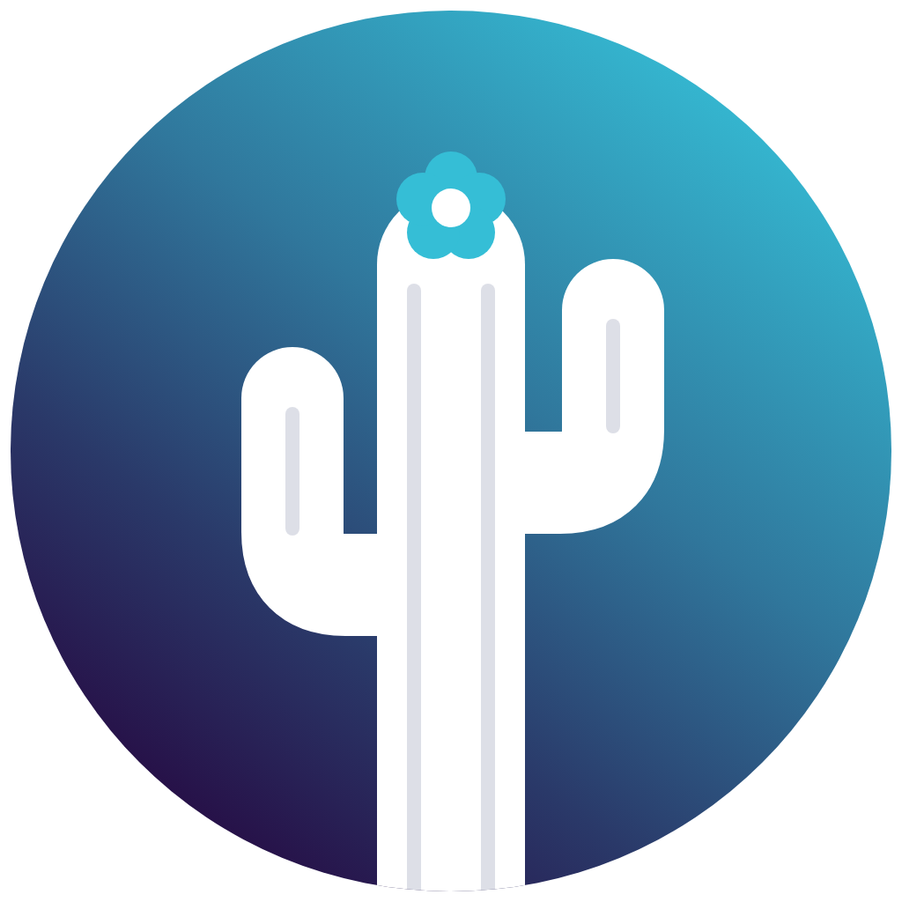
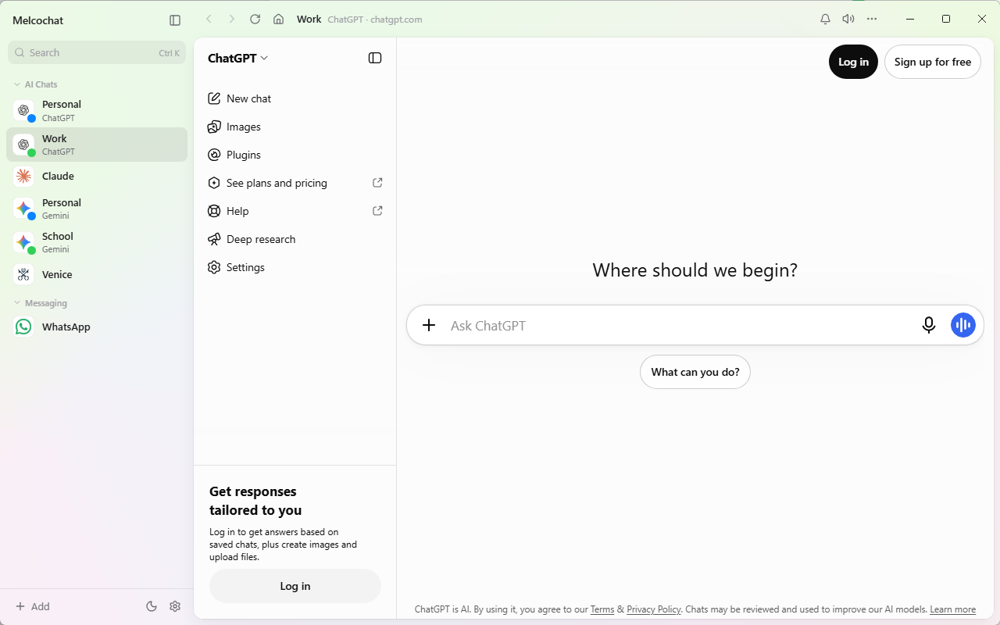

<p align="center"></p>

# Melcochat

All your web apps and AI chats in one clean window, with **true multi-account isolation**. You can keep three ChatGPT accounts, two Gemini accounts, Claude and Venice signed in side by side, next to WhatsApp, Gmail and Slack.



> **Melcochat is a fork of [Hamsket](https://github.com/TheGoddessInari/hamsket), rebuilt from scratch.** The original ran on ExtJS/Sencha Cmd and Electron 20 (2022). This version uses Electron 45, React 19, Vite 8 and TypeScript. The full upstream history is still in git.

The app logo comes from [`build/logo.svg`](build/logo.svg). Regenerate every icon size with `npx electron scripts/render-icons.cjs`.

## What's new

| | Hamsket 0.6 (2022) | Melcochat 1.0 |
|---|---|---|
| Runtime | Electron 20, `<webview>` | Electron 45, `WebContentsView` |
| UI | ExtJS 6 (needs Sencha Cmd) | React 19 + Vite 8, TypeScript |
| Accounts | One per service in practice | Unlimited per service. Each has its own persistent session |
| AI chats | none | 27, including ChatGPT, Claude, Gemini and Venice |
| Look | 2016 tab strip | Sidebar with macOS-style restraint: Mica on Windows 11, vibrancy on macOS, light and dark |
| Logo | Hamster | Cactus, in the same cyan-to-purple gradient |
| Service logos | ~100 bundled PNGs (many dead services) | Live site favicons. Brand-color monogram until a favicon loads |
| Dead services | HipChat, Stride, Hangouts, Skype, Flowdock, Freenode… | Removed |

## Features

- **Multi-account by design.** Every account gets its own `persist:` session partition. Cookies, local storage, IndexedDB and cache never mix between accounts. Use *Add Another Account of This Service* from the `…` menu.
- **Account labels and colors.** "Work", "Personal", "alex@…". When a service has more than one account, a colored dot tells them apart.
- **Sign-in that works.** The app presents a stock Chrome user agent, so it doesn't look like Electron. Google's sign-in page is served a Firefox UA, the same workaround other multi-account apps use. OAuth popups ("Continue with Google/Apple/Microsoft") open in-app and share the account's session.
- **Native notifications.** Web notifications are routed through the OS and labelled with the account. Clicking one jumps to that account. Notifications can be turned off per account, and Do Not Disturb applies to all of them.
- **Unread badges.** Counts are read from page titles and shown in the sidebar, the dock/taskbar badge and the tray tooltip.
- **Quick switcher.** `Ctrl/⌘ K` opens a fuzzy search over your accounts that can also add new apps.
- **Hibernation.** Unload an account to free memory, either manually or automatically after it has been idle.
- **Per-account proxy and zoom.**
- **Sign out of one account** without touching the others (clears only that partition).
- Tray, launch at login, close to tray, spellcheck, drag to reorder, compact icon-only sidebar.

### Keyboard shortcuts

`Ctrl` on Windows/Linux, `⌘` on macOS.

| Shortcut | Action |
|---|---|
| `⌘1` … `⌘9` | Switch to account 1–9 (sidebar order) |
| `Ctrl Tab` / `Ctrl ⇧ Tab` | Next / previous account |
| `⌘K` | Quick switcher |
| `⌘T` | Add account |
| `⌘,` | Settings |
| `⌘\` | Toggle compact sidebar |
| `⌘⇧D` | Toggle Do Not Disturb |
| `⌘R` / `F5` (`⇧` = hard) | Reload |
| `⌘[` `⌘]` / `Alt ←` `Alt →` | Back / forward |
| `⌘=` `⌘-` `⌘0` | Zoom (remembered per account) |
| `F12` | DevTools for the current account |

## Service catalog

Defined in [`src/shared/catalog.ts`](src/shared/catalog.ts). Each entry is a few lines of data.

- **AI Chats (27):** ChatGPT, Claude, Gemini, Venice, Perplexity, Grok, Microsoft Copilot, Microsoft 365 Copilot, Le Chat, DeepSeek, Meta AI, Qwen Chat, Kimi, Z.ai, Poe, HuggingChat, OpenRouter Chat, Duck.ai, LMArena, T3 Chat, NotebookLM, Google AI Studio, GitHub Copilot Chat, Pi, Character.AI, You.com, Manus
- **Messaging:** WhatsApp, Telegram, Slack, Discord, Messenger, Teams, Google Chat, Google Messages, Element, Instagram DMs, LinkedIn, WeChat, Wire, Zalo, Webex, Mattermost, Rocket.Chat, Zulip
- **Email & Calendar:** Gmail, Google Calendar, Outlook, Outlook (M365), Proton Mail, Tuta, Fastmail, iCloud Mail, Yahoo Mail, Zoho Mail, HEY
- **Work:** Notion, Linear, GitHub, GitLab, Jira, Asana, Trello, ClickUp, Todoist, Microsoft To Do, Figma, Google Drive, Google Keep
- **Social & Media:** X, Bluesky, Mastodon, Threads, Reddit, Facebook, YouTube, YouTube Music, Spotify
- **Custom:** any URL

What still needs checking, service by service, is in [docs/SERVICE-VALIDATION.md](docs/SERVICE-VALIDATION.md).

## Develop

Requires Node 22+.

```bash
npm install
npm run dev        # hot-reloading dev build
npm test           # unit tests (node:test)
npm run typecheck
npm run dist       # installers for the current OS → dist/
```

Set `MELCOCHAT_USER_DATA=/some/folder` to run with a separate profile (portable mode or testing).

### Architecture

```
src/
  main/         Electron main process
    index.ts      window, tray, menus, shortcuts, IPC, notifications
    views.ts      ViewManager: one WebContentsView + session partition per account
    userAgent.ts  Chrome UA / Google sign-in workaround
    store.ts      JSON persistence (atomic writes) in userData/
  preload/
    index.ts      typed bridge for the UI (window.melcochat)
    service.ts    injected into web apps: Notification shim → native notifications
  renderer/     React UI (sidebar, toolbar, sheets, quick switcher)
  shared/       types, service catalog, unread parsing
```

The React UI owns the state and sends `views:sync(accounts, activeId, bounds)`. The main process reconciles the native views to match. Web apps run sandboxed, with context isolation on and no Node access.

## Roadmap

- Per-service unread hooks for apps that don't put counts in the title
- Import accounts from Hamsket 0.6 / Rambox / Ferdium
- App lock (master password) — 0.6 had one
- Workspaces (switch whole sets of accounts)
- Split view: two accounts side by side
- "Ask all": send one prompt to several AI chats at once
- Auto-update and signed builds

## License

GPL-3.0, same as upstream. See [LICENSE](LICENSE). Melcochat is a fork of Hamsket, which was itself a fork of Rambox (both GPL-3.0). Service names belong to their owners. No third-party logos are bundled.
